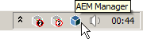
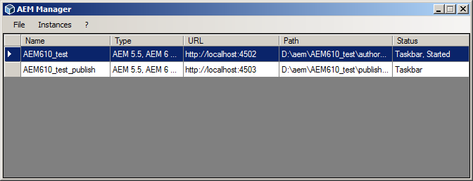
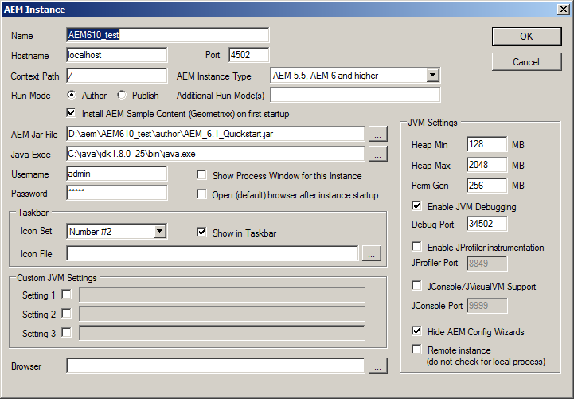
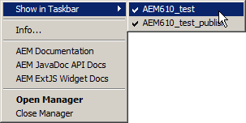
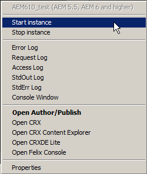
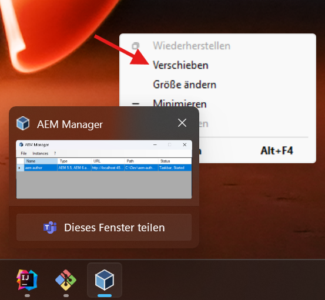

wcm.io AEM Manager for Windows
==============================

Taskbar application for managing AEM instances on Windows.

Overview
---------

The AEM manager is a Windows application that allows to manage local AEM instances for AEM developers. It allows to start, stop instances and monitor their bundles statuses in the taskbar. Via context menu quick links are available to the most important entry points.


Installation
------------

* Download the latest release from the [Releases](https://github.com/wcm-io-devops/aem-manager/releases) section.
* Execute the Windows installer `AEMManagerSetup.msi`
* The AEM manager installs into `Program Files (x86)\AEMManager` and places an "AEM Manager" shortcut in the Startup folder and under `wcm.io` in the Start menu.

Tested with Windows 10 and Windows 11.
Requires .NET Framework 4.8 or later. Run `setup.exe` from the installer build output to install the prerequisite if it is missing, or install it before running the MSI directly.


Building
--------

Build on Windows with:

* [Visual Studio Community 2022](https://visualstudio.microsoft.com/vs/community/) with the **.NET desktop development** workload and the **.NET Framework 4.8 targeting pack**.
* The [Microsoft Visual Studio Installer Projects 2022](https://marketplace.visualstudio.com/items?itemName=VisualStudioClient.MicrosoftVisualStudio2022InstallerProjects) extension.

Open `AEMManager.sln`, restore NuGet packages, select **Release | Any CPU**, and build the solution. The `AEMManagerSetup` project packages the application output, its configuration and dependencies, and the `icons` content files. The MSI and prerequisite bootstrapper are generated in `AEMManagerSetup\Release\` as `AEMManagerSetup.msi` and `setup.exe`. Debug builds use `AEMManagerSetup\Debug\`.

The setup project uses Visual Studio Installer Projects (`.vdproj`), not WiX. No WiX toolset or extension is required. Build it in Visual Studio or with `devenv.com`, not standalone MSBuild or `dotnet build`. From a Visual Studio Developer Command Prompt:

```bat
nuget restore AEMManager.sln
devenv.com AEMManager.sln /Rebuild "Release|Any CPU"
```

For a new release, update `AssemblyVersion` and `AssemblyFileVersion` in `AEMManager\Properties\AssemblyInfo.cs` and the setup project's `ProductVersion` (three numeric parts, currently `2.5.0`). Accept Visual Studio's prompt to generate a new `ProductCode`, but keep `UpgradeCode` unchanged so newer installers can replace older versions. The MSI filename is fixed and no longer includes the assembly version.

When replacing a WiX installer with the same product version, uninstall the old version first. Before publishing, verify installation, Startup and Start menu shortcuts, upgrade from the previous release, and uninstallation on Windows.


Features
--------

After starting the AEM manager a new icon is displayed in the Windows taskbar:



A double click on the icon opens the list of instances



You can define new instances:



The main taskbar icon offers a context menu with some global useful links, and the possible to choose for which instances a separate icon should be displayed in the taskbar:



For each instance icon a context menu offers to start/stop the instance, open log files or open a browser to jump into different entry points:



The startup/bundle status of each instances is visualized in the taskbar icon color/overlay icon color:

Icon | Overlay Icon | State
-----|--------------|-------
 |  | AEM instances is not running
 |  | AEM instances is currently starting or stopped, Felix console is not available, unable to get bundle status
 |  | Some bundles in the AEM instances are currently starting/stopping or could not be started
 |  | AEM instances is running and all bundles are started


Preferences
-----------

From the AEM Manager window you can configure preferences via File > Preferences. Currenty the log viewer application can be configured that is used by the shortcuts to log files of an AEM instance.

It is recommended to install [Otros Log Viewer](https://github.com/otros-systems/otroslogviewer) and configure it in the preference dialog.

Here you will find a customized Log-importer configuration so Otros Log Viewer will understand the default AEM log file format by default: [otros-config](https://github.com/wcm-io/wcm-io-tooling/tree/develop/misc/log-analysis/otros-config).


Trouble Shooting
-----------

If AEM Manager is running and the window disappears - try this:

1. Move the mouse cursor over the icon in the taskbar and click the right mouse button. The following pop-up should appear:



2. Click on "Move" and on the right arrow key of your keyboard while holding the drag and drop cursor.

The AEM Manager Window should appear again  
